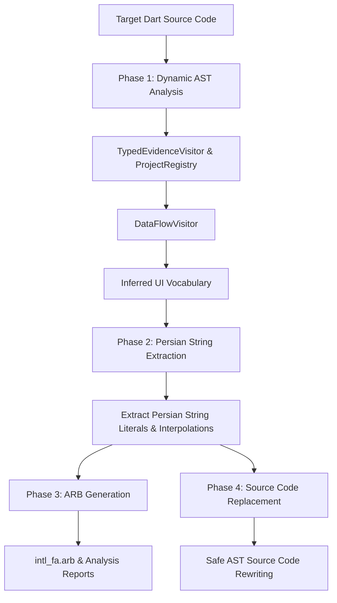

# Persian Localization Tool for Flutter 🇮🇷

An intelligent, AST-powered localization and Persian string extraction engine for Dart and Flutter projects.

Unlike conventional localization tools that rely on fragile hardcoded widget lists and parameter names, this tool dynamically analyzes your project's Abstract Syntax Tree (AST), infers UI indicators and layout containers, traces data-flow into text widgets, and extracts Persian strings automatically.

---

## 🌟 Key Highlights

- **Dynamic UI Vocabulary Discovery:** Automatically identifies layout containers (`Column`, `Row`, `Card`, `Scaffold`, `ListTile`, custom tiles) without maintaining static lists.
- **Data-Flow Tracking:** Analyzes how string parameters flow through custom domain widgets down to core text primitives (`Text`, `RichText`, `SelectableText`).
- **Semantic Parameter Extraction:** Detects textual parameters (`title`, `label`, `message`, `cardTitle`, `doctorName`, etc.) through multi-factor structural evidence scoring.
- **Root Screen Filtering:** Automatically excludes top-level navigation routes and app shells (`*Page`, `*Screen`, `*View`, `*App`) from atomic layout indicators.
- **Safe Code Replacement:** Seamlessly replaces hardcoded strings with localized getters while preserving code formatting, comments, and AST validity.
- **ARB & Diagnostics Generation:** Generates standardized Flutter ARB localization files along with comprehensive reports on dynamic strings and string locations.

---

## 🏛️ Architecture Overview

The tool operates in modular phases using Dart's official `analyzer` package:



### 1. AST Structural Inference
Constructors and method calls are inspected at their call sites for structural arguments (`child`, `children`, `body`, `builder`, `appBar`, `home`, `leading`, `trailing`).

### 2. Data-Flow Propagation
When custom widgets receive string arguments in their constructors, the data-flow visitor tracks whether those arguments are forwarded to underlying text widgets inside the `build()` method. If so, the custom widget is promoted to a recognized text-bearing component.

### 3. Multi-Factor Evidence Scoring
Parameters are evaluated across positive structural usages (string literal frequencies, Dart type hints, UI build context) and negative penalties (non-string types, numeric identifiers, asset paths).

---

## 🚀 Getting Started

### Prerequisites
- Dart SDK `>= 3.0.0 < 4.0.0`
- Flutter SDK (for target Flutter applications)

### Installation

Activate the package globally using Dart pub:

```bash
dart pub global activate --source git https://github.com/AmirrezaSedghamiz/Persian-Localization-Tool-For-Flutter.git
```

Or run directly from the repository:

```bash
dart run bin/localize_persian.dart <command> [options]
```

---

## 📖 CLI Commands & Usage

```bash
dart localize_persian.dart <command> [--path <target_project_path>]
```

| Command | Description |
| :--- | :--- |
| `all` | Executes the complete end-to-end workflow (Analyze → Extract → Build ARB → Replace Source). |
| `analyze-ui` | Runs the dynamic AST analyzer and displays discovered UI indicators, text widgets, and parameters. |
| `extract` | Dynamically infers vocabulary and extracts all Persian strings into memory and reports. |
| `build` | Generates standardized `intl_fa.arb` localization files from extracted strings. |
| `replace` | Replaces hardcoded Persian strings in the target source files with localization keys. |
| `append` | Appends newly extracted strings to an existing ARB file without overwriting existing keys. |
| `analyze` | Generates diagnostic metrics on string frequency, locations, and interpolation patterns. |
| `help` | Displays usage instructions and available options. |

### Examples

#### Inspect discovered UI vocabulary:
```bash
dart localize_persian.dart analyze-ui --path /path/to/flutter_project
```

#### Run extraction only:
```bash
dart localize_persian.dart extract --path /path/to/flutter_project
```

#### Run complete automated localization:
```bash
dart localize_persian.dart all --path /path/to/flutter_project
```

---

## 📁 Project Structure

```
.
├── bin/
│   ├── localize_persian.dart          # Primary CLI executable entrypoint
│   └── persian_string_locator.dart    # Codebase string auditor utility
├── lib/
│   ├── localize_persian.dart          # Public API library exports
│   └── src/
│       ├── analyzer/                  # AST evidence engine & UI vocabulary analyzer
│       │   ├── models/                # Identifier & parameter evidence models
│       │   ├── passes/                # AST traversal passes & data-flow visitors
│       │   └── ui_vocabulary_analyzer.dart
│       ├── application/               # Workflow orchestration service
│       │   └── localization_service.dart
│       ├── domain/                    # State & domain entity models
│       ├── infrastructure/            # Extractors, ARB generators, and AST replacers
│       ├── locator/                   # String audit & locator utility
│       ├── presentation/              # CLI runner & argument parsing
│       └── utils/                     # Persian string detection & normalization
├── pubspec.yaml                       # Package configuration and dependencies
└── README.md
```

---

## 📄 License

This project is licensed under the MIT License. See the [LICENSE](LICENSE) file for details.
